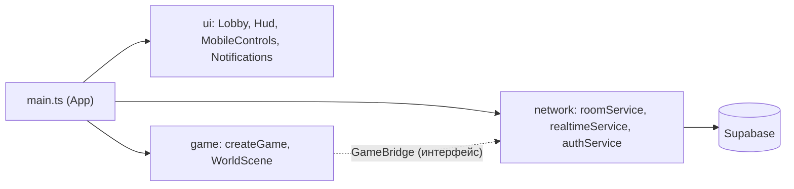

# Техническое описание: «Тайна затерянного мира»

Документ описывает, что реализовано в стартовом прототипе, как устроена архитектура и где подключать будущие механики.

## 1. Цель

Кооперативная 2D-игра (вид сверху) для 3–4 детей на отдельных телефонах. Игра чередуется с заданиями в реальном помещении (поиск карточек, записок). Полный квест в будущем: 60–90 минут.

Прототип проверяет основу: комнаты, общий мир, синхронизацию перемещений, мобильное управление и публикацию.

## 2. Слои и границы ответственности



| Слой | Папка | Знает о |
| --- | --- | --- |
| UI | `src/ui` | типы сети, `VirtualInput` |
| Сеть | `src/network` | Supabase, свои типы |
| Игра | `src/game` | только интерфейс `GameBridge` и типы из `network/types.ts` |
| Сборка | `src/main.ts` | всё, соединяет слои |

Сцены Phaser не импортируют Supabase. Они получают `GameBridge` через `game.registry` и подписываются на события (`players`, `position`, `status`).

### Единый источник состояния игроков

`RealtimeRoom` хранит список игроков (`Player`: `id`, `name`, `color`, `x`, `y`, `connected`, `updatedAt`). Сцена и HUD лишь отображают его. Состав берётся из Presence, позиции обновляются по Broadcast.

## 3. Сеть

### Комната = канал

Канал `room:<КОД>`. Код: 6 символов из алфавита без похожих (`ABCDEFGHJKMNPQRSTUVWXYZ23456789`).

### Присутствие и позиции

- **Presence** (редкое): `{ id, name, color, joinedAt, x, y }`. Ключ присутствия = id анонимного пользователя.
- **Broadcast `pos`** (частое): `{ id, x, y, t }`, не чаще `positionSendHz` (12 Гц), только при изменении, плюс завершающее обновление при остановке и периодический повтор раз в 2.5 с.
- **Broadcast `evt`**: универсальный конверт `GameEvent { type, from, payload, t }` для будущих заданий. Уже есть `sendGameEvent` и событие `gameEvent`.

### Порядок подключения (`RealtimeRoom.connect`)

1. Подписка на канал, ожидание первого `presence sync`.
2. Проверки: `create` и код уже занят: новый код; `join` и в комнате никого: «не найдена»; уже 4 игрока: «заполнена».
3. Выбор свободного цвета, расчёт `joinedAt = max(Date.now(), joinedAt_остальных + 1)` (расхождение часов телефонов не вытесняет старожилов), `track()`.
4. Подтверждение собственной записи, повторная проверка ранга (защита от гонки): если ранг ≥ 4, игрок выходит.
5. Статус `connected`.

Видимыми считаются первые `maxPlayers` записей, упорядоченных по `(joinedAt, id)`.

### Обрывы связи

- Статус `reconnecting` показывается плашкой.
- Библиотека сама переподключает сокет. Если за 4 секунды не восстановилось, канал пересоздаётся (паузы 4 → 6 → 9 → 10 с и далее). Срабатывает также по `online` и при возвращении вкладки.
- После `SUBSCRIBED` выполняется повторный `track()` и ждём собственную запись в Presence. Затем список игроков обновляется без дублей (ключ = id).
- Локальный игрок не теряется: его позиция живёт в клиенте и повторно отправляется.

## 4. Игровой мир

- Размер 2400×1600 (`worldConfig.ts`), границы с отступом 70.
- Графика целиком рисуется кодом (Graphics / Canvas) в `PreloadScene`, затем строится `WorldBuilder`: трава, дорожки из булыжника, центральная площадка с порталом, руины, деревья (кроны становятся прозрачными, когда за ними игрок), светлячки.
- Камера следует за игроком; масштаб подбирается так, чтобы по высоте помещалось ~520 единиц мира.
- Холст рендерится с учётом `devicePixelRatio` (не выше 2).
- Столкновения: простые круги (стволы, колонны, портал) в `MovementSystem`.
- Движение: вектор = клавиатура + джойстик, длина ограничена 1 (диагональ не быстрее).
- Сброс ввода: `blur`, `visibilitychange`, события Phaser `BLUR`/`HIDDEN`, `pointercancel`.

## 5. Интерфейс

- Лобби (`Lobby.ts`), HUD (`Hud.ts`: код, статус связи, игроки, выход), джойстик (`MobileControls.ts`), уведомления (`Notifications.ts`). Системные `alert` не используются.
- Страница не прокручивается (`overflow: hidden`, `touch-action: none`, `overscroll-behavior: none`), учтены safe-area.
- В портретной ориентации на сенсорных устройствах показывается оверлей «Поверните телефон».

## 6. Как добавлять будущие механики

Принцип: **состояние задания живёт в комнате, а не в сцене**. Сцена показывает объекты и передаёт действия игрока в `GameBridge`.

### Общие точки расширения

1. **Фазы комнаты.** В `network/types.ts` есть `RoomPhase` (сейчас `'free_roam'`). Добавьте `lobby`, `playing`, `waiting_real_world`, `waiting_host`, `finished` и рассылайте смену фазы событием `GameEvent`. Сцена и UI реагируют на фазу (блокировка движения, экран «Найдите 3 карточки»).
2. **События.** Любое командное действие это `GameEvent` (`type`: `plate.activate`, `vote.cast`, `item.pick`, `code.submit` и т.д.). Добавьте в `RoomEvents` типизированные события или маршрутизатор по `type`.
3. **Задания как модули.** Папка `src/game/quests/` с интерфейсом вида:
   ```ts
   interface QuestModule {
     id: string;
     start(ctx: QuestContext): void;      // создать объекты в сцене
     onEvent(event: GameEvent): void;     // реакция на сетевые события
     isComplete(): boolean;
     destroy(): void;
   }
   ```
   Сцена хранит список активных модулей и вызывает их из `update`/по событиям.
4. **Авторитетное состояние.** Сегодня правду о событиях определяют клиенты. Для заданий с жёсткими условиями (одновременное нажатие, голосование) перенесите вычисление результата на сервер (RPC / Edge Function с таблицей состояния комнаты) или назначьте «ведущего»-клиента. `GameBridge` при этом остаётся прежним.

### Как ложатся пять заданий

| Задание | Что нужно | Основа в прототипе |
| --- | --- | --- |
| 1. Разделённые подсказки | Личные данные игрока: индивидуальный экран подсказки. Хранить по `player.id`, показывать только владельцу (на сервере через RLS, в прототипе через `GameEvent` с адресатом) | `Player.id`, UI-слой для оверлеев |
| 2. Одновременное действие | Объекты-плиты в мире, зоны активации, таймер окна 10 с, подсчёт активных | Круговые зоны в `WorldBuilder`, события `plate.activate/deactivate`, подсчёт на ведущем/сервере |
| 3. Артефакты | Предметы в мире, у игрока слот `carriedItem`, двери с требованием | Расширить `Player` и presence; событие `item.pick/drop` |
| 4. Командный выбор | Три пути, голосование, итог по большинству | Событие `vote.cast`, подсчёт на сервере/ведущем, фаза `voting` |
| 5. Совместная сборка | Детали по карте, общий инвентарь, активация портала | Общий инвентарь комнаты в состоянии комнаты, портал уже есть в центре мира |

### Чередование игры и реальности

Фазы `waiting_real_world` и `waiting_host` позволяют поставить игру на паузу: показать задание («найдите три символа»), принять ввод кода (`code.submit`), дождаться подтверждения ведущего (`host.confirm`) и перейти к следующему этапу (`stage.next`). Для этого достаточно экрана-оверлея в UI и события в `GameEvent`; переписывать мир и сеть не потребуется.

### Ведущий, прогресс, повторное подключение

- **Ведущий:** отдельная роль в Presence (`role: 'host'`) или серверная проверка через `room_members`.
- **Прогресс:** таблица `rooms.progress (jsonb)`; клиент при входе читает состояние комнаты.
- **Повторное подключение:** id анонимного пользователя сохранён в `sessionStorage`. Для надёжного возврата после закрытия вкладки перейдите на `localStorage` (и хранение «последней комнаты») либо на постоянные аккаунты.

## 7. Что сознательно не делается

Регистрация по email, личные кабинеты, конструктор квестов, панель ведущего, несколько миров, роли, инвентарь, сохранение прогресса. Прототип решает одну задачу: несколько детей двигаются по общей карте.

## 8. Безопасность

См. [SUPABASE_SETUP.md](SUPABASE_SETUP.md), раздел «Ограничения безопасности прототипа».
